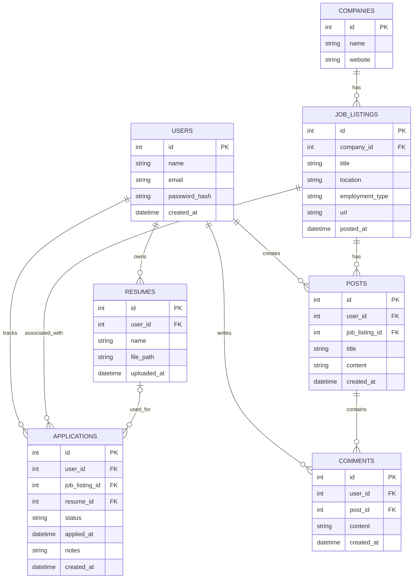

# Database ERD (Draft)

This is the initial database design for our job application tracker. The schema is subject to change as we finalize the application's features.

## Questions for the Team

- Should users be able to track applications without an existing job listing?
- Should companies have their own table?
- How should resumes be stored and associated with applications?
- Should comments support replies to other comments?
- What fields should be required or optional?
- What should happen to related records when a user, listing, or post is deleted?

These decisions need to be reviewed before the schema is finalized and migrations are implemented.
