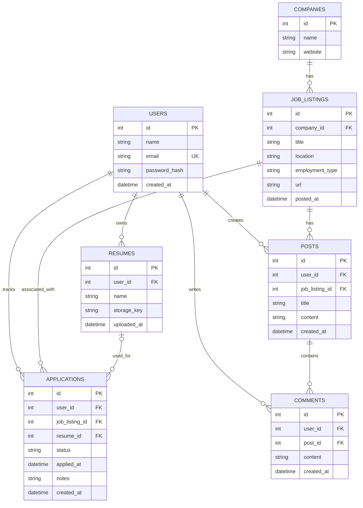

# Database ERD (Draft)

This is the initial database design for our job application tracker. The schema is subject to change as we finalize the application's features.

## Questions for the Team

This ERD is an initial draft based on our current project requirements. We can adjust the tables and relationships as we finalize the application's features.

### Application Features
- Should users be able to track applications for jobs that aren't already in the shared job listings database?
- Do we want companies stored in a separate table, or would storing company information directly in job listings be sufficient?
- Should users be able to reply to individual comments, or only comment directly on discussion posts?

### Authentication and File Storage
- How should we handle user authentication and sessions? Will we use password-based authentication with Express sessions or an external authentication provider? (external could count as our "extra feature" but might be more work to implement compared to other "extra feature" options)
- Which object storage service should we use for uploaded resumes (e.g., Amazon S3)? What file information should we store in the database?

### Database Relationships
- Which fields should be required versus optional?
- What should happen to related records when a user, job listing, or discussion post is deleted?
- Should users be able to reuse the same resume across multiple applications?

### Other Project Requirements
- Which extra feature should we implement? One option is automated testing with GitHub Actions, which wouldn't require additional database tables.

We should agree on the main database structure before finalizing the Kysely migrations, but smaller changes can still be made later.