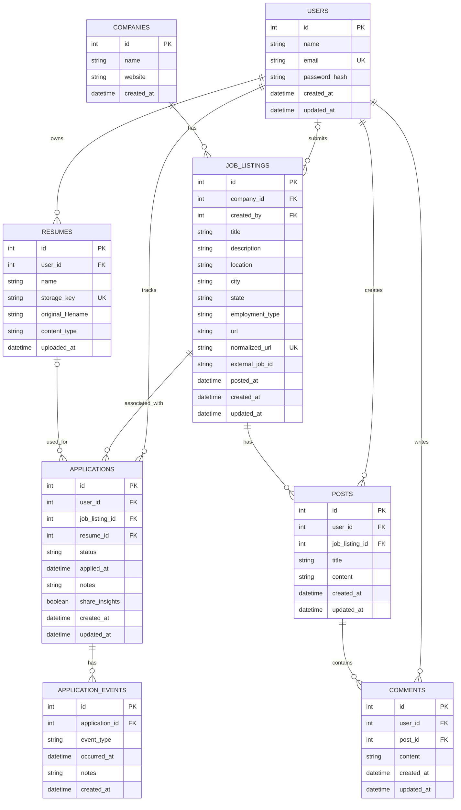

# Database ERD

Database design for our job application tracker and job-specific discussion forum.

## Database Design Notes

- **Required CRUD resources:** Users, Posts, and Comments.
- **Job listings:** Users can submit job listings. Duplicate listings will be checked using URLs, company job IDs, and possible matches.
- **Applications:** Each application belongs to one user and one job listing. Applications are private and may optionally reference a resume.
- **Application timelines:** Application events track stages such as applying, interviews, offers, and rejections.
- **Community statistics:** Users can optionally share anonymous hiring insights. `share_insights` defaults to `false`.
- **Resumes:** Files will be stored in object storage, with file information saved in PostgreSQL.
- **Deletion behavior:** Deleting applications removes their events, deleting posts removes their comments, and deleting resumes sets the associated application's `resume_id` to NULL.
- **Authentication:** Passwords will be stored as hashes. Session handling will be implemented in the backend.
